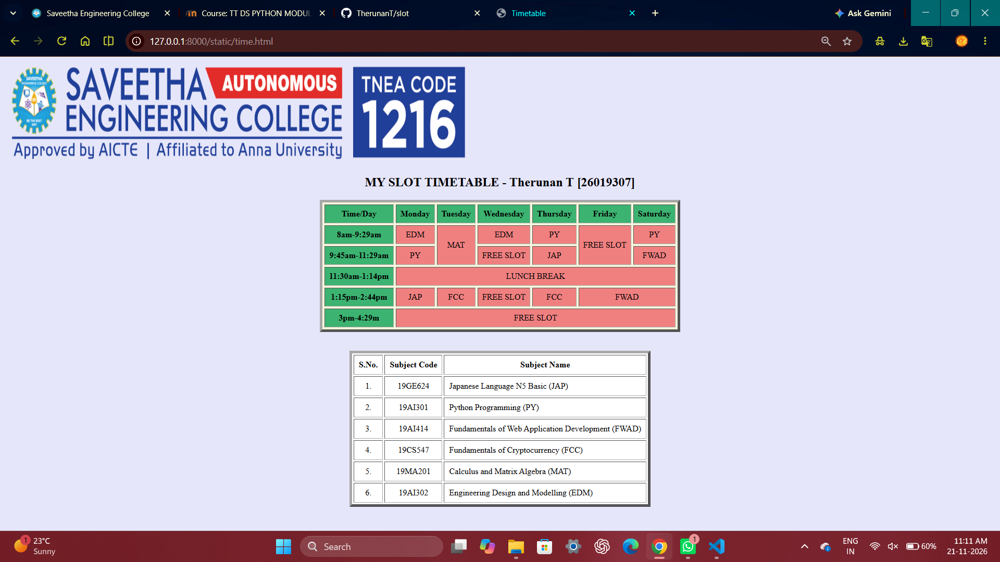

# Ex04 Time Table
## Date: 21-11-2026

## AIM
To write a html webpage page to display your slot timetable.

## ALGORITHM
### STEP 1
Create a Django-admin Interface.

### STEP 2
Create an App inside the Django project.

### STEP 2
Create a static folder uder the created App and insert HTML code.

### STEP 3
Create a simple table using ```<table>``` tag in html with the relevant attributes.

### STEP 4
Add rows using ```<tr>``` tag.

### STEP 5
Add your course schedule using ```<td>``` tag.

### STEP 6
Execute the program using runserver command.

## PROGRAM
```
<html>
    <head>
        <title>Timetable</title>
    </head>
    <body bgcolor="lavender">
        
        <h2 align="center">MY SLOT TIMETABLE - Therunan T [26019307] </h2>
        <table border="5" cellpadding="8" cellspacing="4" align="center" bgcolor="beige">
            <tr align="center"  bgcolor="mediumseagreen" >
                <th>Time/Day</th>
                <th>Monday</th>
                <th>Tuesday</th>
                <th>Wednesday</th>
                <th>Thursday</th>
                <th>Friday</th>
                <th>Saturday</th>
            </tr>
            <tr align="center" bgcolor="lightcoral">
                <th bgcolor="mediumseagreen">8am-9:29am</th>
                <td>EDM</td>
                <td rowspan="2">MAT</td>
                <td>EDM</td>
                <td>PY</td>
                <td rowspan="2">FREE SLOT</td>
                <td>PY</td>

            </tr>
            <tr align="center" bgcolor="lightcoral">
                <th bgcolor="mediumseagreen">9:45am-11:29am</th>
                <td>PY</td>
                <td>FREE SLOT</td>
                <td>JAP</td>
                <td>FWAD</td>

            </tr>
            <tr align="center" bgcolor="lightcoral">
                <th bgcolor="mediumseagreen">11:30am-1:14pm</th>
                <td colspan="6">LUNCH BREAK</td>
            <tr align="center" bgcolor="lightcoral">
                <th bgcolor="mediumseagreen">1:15pm-2:44pm</th>
                <td>JAP</td>
                <td>FCC</td>
                <td>FREE SLOT</td>
                <td>FCC</td>
                <td colspan="2">FWAD</td>
            </tr>
            <tr align="center" bgcolor="lightcoral">
                <th bgcolor="mediumseagreen">3pm-4:29m</th>
                <td colspan="6">FREE SLOT</td>
            </tr>
        </table>
        <br>
        <br>
        <table border="5" cellpadding="9" cellspacing="3" align="center" bgcolor="white">
            <tr align="center">
                <th>S.No.</th>
                <th>Subject Code</th>
                <th>Subject Name</th>
            </tr>
            <tr align="center">
                <td>1.</td>
                <td>19GE624</td>
                <td align="left">Japanese Language N5 Basic (JAP)</td>
            </tr>
            <tr align="center">
                <td>2.</td>
                <td>19AI301</td>
                <td align="left">Python Programming (PY)</td>
            </tr>
            <tr align="center">
                <td>3.</td>
                <td>19AI414</td>
                <td align="left">Fundamentals of Web Application Development (FWAD)</td>
            </tr>
            <tr align="center">
                <td>4.</td>
                <td>19CS547</td>
                <td align="left">Fundamentals of Cryptocurrency (FCC)</td>
            </tr>
            <tr align="center">
                <td>5.</td>
                <td>19MA201</td>
                <td align="left">Calculus and Matrix Algebra (MAT)</td>
            </tr>
            <tr align="center">
                <td>6.</td>
                <td>19AI302</td>
                <td align="left">Engineering Design and Modelling (EDM)</td>
            </tr>
        </table>

      </body>
</html>
```


## OUTPUT



## RESULT
The program for creating slot timetable using basic HTML tags is executed successfully.
